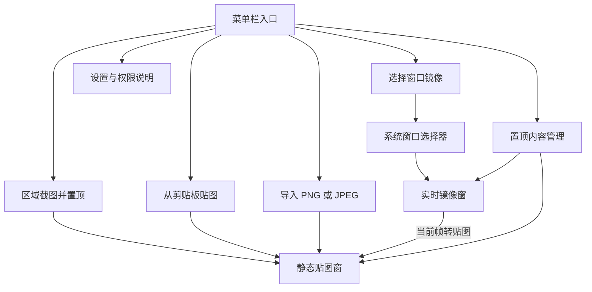

# 「置顶 / Zhiding」产品与交互设计

版本：v0.1。状态：首版交互目标，已有部分原生实现；本文不代表全部交互已验收。开发版差异和测试记录见 [当前实现与本机验证](./03-开发路线与验收标准.md#12-当前实现与本机验证)。

导航：[设计总览](./00-设计总览.md) · [技术与隐私](./02-技术架构与隐私安全设计.md) · [开发与验收](./03-开发路线与验收标准.md)

## 1. 体验原则

1. 参考信息常驻，用户原来的工作不被反复打断；普通悬浮窗展示和拖动不主动激活本应用。
2. 不让「镜像」看起来像可交互的原窗口；镜像内容只读，工具条才是可操作区域。
3. 每个置顶对象都独立管理，关闭一张不会影响其他对象或原应用。
4. 隐藏、停止、关闭语义明确；隐藏捕获必须有可见提示，不能暗示已经停止。
5. 权限与具体动作绑定；不在启动时索取屏幕、键盘等一揽子访问权。
6. 出错不丢已有内容，不自动捕获新来源；总能从菜单恢复穿透或隐藏的窗口。

## 2. 信息架构



首版不提供大而全的主页。设置与管理界面按需显示；关闭这些界面不退出应用，也不关闭已有贴图或镜像。

## 3. 菜单栏与首次使用

### 3.1 菜单原型

```text
[置顶图标]
┌────────────────────────────────────┐
│ 置顶内容：贴图 4 · 镜像 2          │
│ 捕获中 2 路（其中隐藏 1 路）       │
├────────────────────────────────────┤
│ 区域截图并置顶              ⌥⌘1   │
│ 选择窗口镜像                ⌥⌘2   │
│ 从剪贴板贴图                ⌥⌘3   │
│ 导入图片…                          │
│ 原窗口置顶不可用 · 查看说明…       │
├────────────────────────────────────┤
│ 置顶内容管理…                      │
│ 全部隐藏                    ⌥⌘0   │
│ 解除全部鼠标穿透                   │
│ 关闭全部…                          │
├────────────────────────────────────┤
│ 设置…                              │
│ 使用说明与隐私…                    │
│ 关于置顶…                          │
│ 退出置顶                           │
└────────────────────────────────────┘
```

- 有可见对象时显示「全部隐藏」，全部已隐藏时显示「全部显示」；没有对象时禁用该项。
- 数量包含隐藏、已停止和失败占位对象；「捕获中」计数只包含尚未结束的实际会话，系统暂停更新的会话仍计入。
- 没有穿透对象时禁用「解除全部鼠标穿透」；执行后保持各对象原有显示状态。
- 导入入口不要求屏幕录制权限；剪贴板只在用户点选或使用对应快捷键时读取，不轮询。
- 「原窗口置顶不可用 · 查看说明」只说明能力边界，不再枚举窗口、申请辅助功能权限或生成置顶记录。
- 同时只开放一个截图框选或系统选择流程。重复触发提示「正在选择内容，请先完成或取消」，不排队启动多个选择器。
- 菜单图标保持系统标准模板图标风格；状态文本提供 VoiceOver 标签，不只以颜色或小点表达正在捕获。

### 3.2 首次启动

显示一次可关闭的说明窗，不触发权限弹窗：

```text
让参考内容始终可见

窗口镜像：实时显示你选择的窗口，仅供查看。
截图贴图：截取一个区域，可以同时保留多张。
画面默认不保存、不上传；退出后不会自动恢复。

[选择窗口镜像]  [区域截图]  [稍后使用]
```

只有用户打开设置、管理界面、文件选择器或截图框选时，才按需获取本应用交互焦点。普通贴图出现不自动打断编辑器输入。

## 4. 区域截图并置顶

### 4.1 主流程

1. 记录触发时鼠标所在显示器及当前前台应用；无法确定显示器时使用主显示器。
2. 检查 20 张贴图上限，预留创建名额及底图峰值内存预算；不足则直接提示，不申请无用权限。
3. 检查区域截图权限。未获准时显示用途说明；仅在用户选择继续后触发系统授权流程。
4. 关闭菜单，读取显示器静态快照。过滤本应用全部窗口，包括贴图、镜像、设置及管理界面；不以捕获到自己后再擦除的方式处理。
5. 底图成功后，在该显示器显示冻结画面框选层。其他显示器不蒙版、不参与本次选区。
6. 用户拖拽矩形，松开完成。选区至少 2×2 pt 且像素裁剪非空；点击但未形成有效范围不创建贴图。
7. 裁剪、校验尺寸和内存，创建独立静态贴图；释放全屏底图、框选层和临时资源。
8. 贴图显示在选区附近，并限制在屏幕可见区域内；不自动复制或保存。

```text
冻结的屏幕画面                         [Esc 取消]
┌──────────────────────────────────────────┐
│          ┌──────────────────┐            │
│          │     选中区域     │            │
│          └──────────────────┘            │
│          640 × 360 px                      │
│ 拖拽选择，松开置顶 · 本次仅截取当前屏幕    │
└──────────────────────────────────────────┘
```

尺寸标签显示最终预计像素值，不显示未转换的 pt 作为 px。框选期间桌面内容变化不更新底图，避免选区与结果错位。

### 4.2 取消、失败和屏幕变化

| 情况 | 处理 |
| --- | --- |
| `Esc` | 立即取消，释放底图和名额，不创建图片、不写剪贴板 |
| 指针拖出当前显示器 | 选区裁剪到当前显示器边界，提示本次不跨屏 |
| 显示器拔除、分辨率或旋转发生变化 | 取消当前框选，提示重新截取，不沿用旧坐标 |
| 截图失败或权限撤销 | 不显示假的空白截图；提示重试或检查权限 |
| 原图超过预算、裁剪或转色失败 | 丢弃本次结果；已有贴图不变 |
| 截图期间锁屏、睡眠或会话退出 | 中止任务；迟到的底图和裁剪结果直接释放 |
| 首次授权后需要重启 | 提示手动重启；重启前若有未导出内容，走退出确认，不自动重启 |

恢复输入遵循系统焦点行为；不调用反复激活第三方 App 的逻辑，更不因框选结束自动提升某个源窗口。

## 5. 静态贴图窗

### 5.1 文本原型

```text
┌────────────────────────────────────┐
│ [静态] 贴图 03               [关闭]│ ← 悬停时出现
│                                    │
│             图片内容               │
│                                    │
│ [复制] [保存] [100%] [穿透] [更多]  │ ← 悬停时出现
└────────────────────────────────────┘
```

- 内容不拉伸；默认不裁掉原图。工具条叠加于视图，不成为图像资产的一部分。
- 内容非控制区域可拖动；边缘或右下角可等比缩放。缩放不改变原始图像质量。
- 背景透明图保留 Alpha；窗口圆角与阴影只是展示效果，导出不包含它们。
- 大图初次等比适配 640×480 pt。来自截图的逻辑尺寸依据实际捕获比例；普通导入图片默认 1 px 对应 1 pt，不采信文件 DPI 决定窗口大小。
- 极小图片放入最小可操作的 160×100 pt 容器居中展示，不放大图片本身；大图可缩放至可见屏幕范围，越界时自动约束窗口。
- 缩小时容纳不了完整工具条，将次要操作收进「更多」；所有操作仍能从管理界面访问。

### 5.2 操作规则

| 操作 | 行为 |
| --- | --- |
| 复制 | 将完整、原始分辨率的静态图以 PNG 写入剪贴板；不含工具条、透明度效果或阴影 |
| 保存 | 系统保存对话框导出 PNG；成功后才标为已导出；取消或失败不修改图像 |
| 透明度 | 20%—100%，5% 步进；只作用于内容，工具条保持可读 |
| 鼠标穿透 | 首次开启前说明恢复入口；开启后整张悬浮窗忽略鼠标 |
| 隐藏 | 保留图像与布局，可从管理列表恢复 |
| 关闭 | 立即丢弃该运行时贴图；单张关闭不反复确认，无撤销历史 |
| 更多 | 隐藏、恢复初始大小、关闭；不提供首版范围外的编辑器 |

导出默认名形如 `Zhiding-YYYYMMDD-HHMMSS-03.png`，不把其他 App 窗口标题或来源路径写入文件名。覆盖同名文件由系统保存对话框确认。

### 5.3 剪贴板与导入

- 剪贴板读取优先 PNG，其次 TIFF（适配 macOS 常见原生图片表示）；只读此次用户操作时的快照，一次创建一张，不监听后续变化。
- 剪贴板没有支持的图片时提示「剪贴板里没有可用图片」；不下载剪贴板 URL、不解析富文本中的图片链接、不执行文件路径。
- TIFF 剪贴板数据经校验后转为单帧 SDR 图像；本地文件入口仍仅接受 PNG/JPEG。
- 本地导入使用系统文件选择器，一次一个文件；基于实际文件格式、尺寸和解码结果校验，不只依赖扩展名。
- PNG/JPEG 先读取元数据、检查 32 MP 与 50 MiB 上限，再分配解码内存；方向信息规范化，动画或多页输入只使用首帧并提示。
- 超限直接拒绝，不静默压缩或降低原图质量；用户可以自行缩小图片后重试。

## 6. 窗口实时镜像

### 6.1 新建流程

1. 检查最多 3 个镜像对象的限制，已停止、隐藏和创建中的镜像也占用名额。
2. 呈现系统 `SCContentSharingPicker`，仅允许选择单个窗口，排除本应用。
3. 不先枚举整个桌面窗口列表；没有全局屏幕录制权限时仍允许走系统选择器会话授权路径。
4. 用户确认后检查资源，创建镜像会话及加载占位窗；不展示其他来源的上一帧。
5. 第一张有效帧到达后显示画面和「实时」标签。等待超过 10 秒显示「尚未收到画面，可继续等待或关闭」，不把超时直接等同为权限失败。
6. 新建时用户取消选择则不创建对象，释放预留名额；选择失败显示错误，不反复弹出选择器。已有停止/失败占位窗的重新选择若被取消，保留原占位窗和原状态。

```text
┌────────────────────────────────────────┐
│ [实时] 镜像 02                  [关闭]│
│                                        │
│             所选窗口画面               │
│                                        │
│ 仅查看，请切回原应用操作                │
│ [当前帧转贴图] [停止] [100%] [穿透]    │
└────────────────────────────────────────┘
```

首版使用「镜像 01」等会话内编号，不以获得窗口标题或 PID 为必要条件。编号不是可恢复源窗口标识，退出后重新编号。

### 6.2 查看与操作

- 初始镜像内容同样等比适配 640×480 pt；修改镜像大小不调整源窗口的尺寸。
- 普通点击镜像内容只用于拖动或选择本应用控件；滚轮不向源应用转发。
- 顶部保留简洁状态标签；详细时间在悬停工具条和管理界面显示，不在静态内容上反复高频重绘。
- 「当前帧转贴图」复制最后一张有效帧，注明其最后更新时间。没有有效帧、处于隐私停止或画面已清除时禁用；转换后镜像继续运行。
- 「停止」结束会话但保留明确标注的最后一帧及管理入口。停止后只有「重新选择」可以启动新捕获，不假定旧授权有效。
- 已运行镜像需要换源时，通过管理列表「重新选择」呈现关联选择器；取消保留原来源。用户确认新源后立即清除旧帧，等待新来源第一帧；资源不足或换源失败则停止该镜像并保留错误占位，不回退捕获旧源。
- 系统自身共享界面结束会话时，应用必须同步停止，不自动重开。

### 6.3 状态语义

| 显示状态 | 依据 | 展示与可用动作 |
| --- | --- | --- |
| 正在选择 / 正在连接 | 用户选择流程或流启动未完成 | 可取消/关闭，不提供转贴图 |
| 实时 | 收到有效帧且会话未结束 | 查看、转贴图、停止、隐藏、关闭 |
| 实时 · 最后更新于… | 没有新画面但没有明确停止信号，或收到 `idle` | 保留最后帧；不声称源窗口已经最小化或断开 |
| 暂停更新 | 框架明确报告暂停类状态 | 保留标注的最后帧；保持会话，等待有效帧；可主动停止 |
| 已停止 | 用户停止或已知来源结束 | 显示带状态的最后帧或占位；重新选择/关闭 |
| 隐私停止 | 系统停止共享、权限失效、锁屏/睡眠/会话离开等 | 清除镜像帧并显示占位；用户重新选择，不自动恢复 |
| 捕获失败 | 框架错误或有效性校验失败 | 清除画面，给出重选/关闭入口，不自动换源 |

源窗口最小化可能暂停输出，但不能仅凭无新帧判断其原因。[官方能力] 单窗口被普通窗口遮挡、移到其他显示器或 Space 仍可捕获；具体 App 自己停止绘制时，镜像无法制造更新。

源窗口关闭可能以流停止或错误表现；无法可靠识别原因时使用「捕获已结束，请重新选择」，不编造「应用已退出」等具体结论。单窗口镜像不保证包括来源的弹出菜单、子窗口、工具提示或独立对话框。

## 7. 管理列表与批量操作

```text
置顶内容管理                                [完成]
贴图 4 / 20 · 镜像 2 / 3 · 捕获中 2 路

类型   名称       状态              操作
镜像   镜像 02    实时 · 隐藏       显示 / 停止 / 更多
镜像   镜像 01    实时 · 显示       定位 / 隐藏 / 停止 / 更多
静态   贴图 04    显示 · 已导出     定位 / 隐藏 / 保存 / 关闭
静态   贴图 03    显示 · 穿透       定位 / 解除穿透 / 关闭
静态   贴图 02    隐藏 · 未导出     显示 / 保存 / 关闭
静态   贴图 01    显示 · 100%       定位 / 隐藏 / 保存 / 关闭

[全部隐藏] [解除全部鼠标穿透] [关闭全部…]
提示：隐藏镜像仍在捕获；停止或关闭镜像可结束捕获。
```

- 默认按创建时间倒序排列；使用复用的静态缩略图，不为管理列表创建额外捕获流。
- 「定位」仅定位本应用悬浮窗：显示它、在当前可用屏幕内短暂描边；不操作源窗口。若处于隐私遮罩，先让用户确认恢复显示。
- 行内「更多」包括重新选择、转贴图、透明度；所有功能可用键盘导航与 VoiceOver 操作。
- 全部隐藏：将当前所有对象标记为用户隐藏；全部显示：清除所有对象的用户隐藏标记。新创建对象总是可见，不继承上一次批量隐藏操作。
- 隐藏镜像将捕获频率上限降到 1 fps，菜单持续显示活跃会话数量；这不是停止共享。
- 解除全部穿透不自动显示隐藏对象；管理界面本身永远不设置鼠标穿透。
- 手工操作过的对象在同级浮动窗中置前；不试图压过其他应用自己的浮动窗。
- 原窗口置顶的旧实验路线已撤下；不再显示伪置顶记录或「重新应用/解除」控件，见 8.4。

### 7.1 关闭全部与退出

静态图按来源区分：区域截图、剪贴板图、镜像转贴图在成功保存 PNG 前为「未导出」；从本地文件导入的图已有外部副本。复制到剪贴板不算保存文件，仍可能在退出时提示。

- 单张「关闭」是明确丢弃动作，不弹确认；首次使用说明及关闭按钮提示标注这一点。
- 「关闭全部」或「退出」存在未导出静态图时，显示数量并提供「返回管理」「丢弃并关闭/退出」「取消」。不暗示会自动保存。
- 默认焦点在「取消」；返回管理后用户逐张保存，首版不加入批量保存目录流程。
- 没有未导出静态图时可以直接关闭全部或退出；所有活跃流仍需结束并清理。
- 关闭全部保留菜单栏应用；退出移除菜单栏图标并注销快捷键。
- 已在执行的用户导出可以完成，但不能因完成回调重建已关闭的贴图；退出等待这类任务结束或报告失败，不静默丢弃进行中的保存。
- 崩溃、强制退出或系统强制终止无法保证弹出确认；不承诺恢复未导出内容。

## 8. 权限与隐私交互

### 8.1 两条独立授权路径

```text
区域截图需要读取当前屏幕

用于冻结画面并截取你框选的区域。
本应用窗口不会被包含，画面不上传、不自动保存。

[取消] [继续并请求系统授权]
```

- 镜像：系统选择器负责让用户选择并授权所需内容；应用不先要求开启全屏录制权限。
- 区域截图：检查屏幕录制权限，用户拒绝后提供说明和直接定位「屏幕录制」面板的入口（深链失败退回系统设置根页），不循环申请。
- 系统设置中的名称可能随版本变化，可能包含「屏幕与系统音频录制」；说明本产品不采集音频，不伪装系统文案。
- 系统设置深链不可用时，打开系统设置并提供手动导航说明；不把跳转失败解释成无法授权。
- 系统要求重启应用时，必须先处理未保存贴图，不能自动结束用户会话。

### 8.2 锁屏、睡眠与会话切换

[设计决策] 进入已检测的保护状态时：取消选择/截图任务，立即阻止新帧展示，隐藏所有贴图，停止捕获并清除镜像帧。静态图只在内存中暂存，显示恢复前不在列表缩略图中露出。

返回桌面后显示保护原因（系统休眠、显示器休眠、用户会话离开或内存压力）与「内容已隐藏，镜像已请求停止」；停止结果以会话返回值为准：

- 用户选择「恢复显示」只恢复静态图及镜像占位窗，并保留用户之前主动隐藏的对象。
- 用户逐个选择镜像的「重新选择」恢复捕获；不会因为解锁、唤醒或系统通知自动重新开始。
- 用户在保护状态点击截图、镜像、粘贴、导入或触发对应快捷键时，就地询问「恢复显示并继续本次操作？」；取消则不读屏、不读取剪贴板、不显示旧内容，确认后直接继续，无需预先去菜单点击恢复。
- 确认期间发生新保护事件时，旧确认失效。设置、权限直达和能力说明不被隐私隐藏拦截；忙碌时显示原因，不再静默无响应或要求关闭全部。
- 原先手动隐藏的对象继续隐藏，旧镜像不自动重启。
- 锁屏检测的跨系统完整性属于发布阻断项；公开休眠/会话通知不保证覆盖所有锁屏路径，详见技术文档与验收门槛 G03。

### 8.3 不做隐私误导

「不自动保存」表示应用不主动将画面写到历史库或缓存文件；不表示能阻止系统换页、系统诊断或其他已获授权的录屏软件。主动复制、导出后的数据可能由剪贴板同步、用户文件备份或其他应用继续处理，本应用不宣称能召回或安全擦除这些副本。

### 8.4 原窗口置顶不可用说明

旧版将只读 `AXSubrole` 误当成可写层级；当前 Debug/Release 均撤下该路线，只保留说明入口，不再要求用户反复授权。系统窗口镜像选择器可捕获的窗口，不等于可由辅助功能修改层级的窗口。

- 显示「原窗口置顶暂不可用」及真实原因；不再报「未发现窗口」「未授权」或「已置顶」。
- 用户对可操作原窗口置顶的需求仍保留，但尚无实现。用户主动选择「窗口镜像（仅查看）」才进入镜像流程，不自动替换需求。
- 现有辅助功能授权不会被程序重置；设置中的直达入口仅供查看或自行撤销旧版授权。
- 权限深链被系统接收不代表已到达指定面板，更不代表授权成功；屏幕录制跳转后使用非模态文字指引，避免应用弹窗重新挡住系统设置。

## 9. 视觉规范与可访问性

| 项目 | 首版规范 |
| --- | --- |
| 字体 | macOS 系统字体；正文 13 pt，辅助说明 11 pt，关键状态 12 pt |
| 配色 | 使用语义色，跟随浅色/深色；不以自绘亮色遮住系统权限窗口 |
| 间距 | 以 4/8/12/16 pt 为主；工具条点击目标至少 28×28 pt |
| 边界 | 内容容器约 8 pt 圆角、轻阴影；截取与保存不包含装饰 |
| 状态 | 图标 + 文字；实时、暂停、停止可被读屏区分 |
| 动画 | 工具条淡入淡出约 120 ms；尊重系统「减少动态效果」 |
| 透明度 | 内容可调，工具条和错误提示保持可读；尊重「减少透明度」 |
| 键盘 | 管理界面支持 Tab、方向键、Return 与 Esc；截图支持 Esc；不依赖全局键盘监听 |
| 焦点 | 普通参考窗不抢焦点；需要键盘操作时从正常管理窗进入 |

## 10. 设置与快捷键

设置窗口包含「通用」「快捷键」「权限与隐私」「关于」四组，不加入首版范围外的偏好。

- 通用：外观跟随系统；展示内存保留说明、数量和资源上限；首版帧率与上限不提供任意数值输入。
- 快捷键：四个默认组合 `⌥⌘1`、`⌥⌘2`、`⌥⌘3`、`⌥⌘0`，允许修改或禁用。
- 同一功能修改失败时保留原快捷键；可识别的全局注册冲突显示失败原因，不覆盖其他应用的注册。
- 只允许包含 `Command`、`Option` 或 `Control` 中至少一个修饰键的组合，拒绝常见系统保留组合；不能宣称可以发现所有应用内部的快捷键冲突。
- 菜单操作始终可用；关闭全部快捷键不影响核心功能，不因此请求输入监控或辅助功能权限。
- 权限页分别展示区域截图权限状态与当前镜像会话数；系统 preflight 返回未获准时不伪装为能准确区分「从未申请」和「明确拒绝」。
- 原窗口置顶开关已移除，改为能力说明；旧开关设置不再生效。权限页分别提供屏幕录制、已有辅助功能授权与隐私根页的直达入口。

## 11. 异常文案与恢复入口

| 编号 | 条件 | 文案 | 恢复 |
| --- | --- | --- | --- |
| E01 | 区域截图未获准 | 区域截图需要屏幕录制权限。窗口镜像和图片导入仍可单独使用。 | 说明 / 自动打开屏幕录制设置 |
| E02 | 空剪贴板或格式不支持 | 剪贴板里没有可用图片。请复制图片后重试。 | 关闭提示 |
| E03 | 贴图达到 20 张 | 已达到 20 张贴图上限。请先关闭部分贴图。 | 打开管理 |
| E04 | 镜像达到 3 个 | 已达到 3 个镜像上限。已停止的镜像也占用名额。 | 打开管理 |
| E05 | 资源预算不足 | 本次内容需要的图像内存超过预算，已有内容未改变。 | 打开管理 / 取消 |
| E06 | 图片尺寸或文件过大 | 图片超过 32 MP 或 50 MiB 限制，请缩小后重试。 | 重新选择 |
| E07 | 镜像结束且原因不明 | 捕获已结束，请重新选择窗口。 | 重新选择 / 关闭 |
| E08 | 系统停止共享或权限失效 | 屏幕共享已停止，画面已清除。 | 重新选择 / 关闭 |
| E09 | 图像保存失败 | 图片未保存，当前贴图仍保留。 | 重新保存 / 取消 |
| E10 | 显示器变化打断截图 | 屏幕布局已变化，本次截图已取消。 | 重新截图 |
| E11 | 快捷键注册失败 | 无法注册该快捷键，原设置保持不变。 | 修改 / 禁用 |
| E12 | 隐私保护触发 | 显示保护原因，内容已隐藏，镜像已请求停止。 | 点击功能就地确认恢复并继续 / 取消保持隐藏 |
| E13 | 暂无首帧 | 尚未收到画面，可继续等待或关闭。 | 等待 / 关闭 |
| E14 | 受保护内容或空白画面 | 当前内容无法正常显示，可能受系统或应用限制。 | 切回原应用检查 / 关闭 |
| E15 | 系统选择器启动失败 | 无法打开窗口选择器，请稍后重试。 | 重试 / 取消 |
| E16 | 原窗口置顶入口 | 当前实现不支持可操作原窗口置顶，继续授权不能解决。 | 查看原因 / 主动选择只读镜像 |

旧 E17–E19 的 AX 写入/还原流程已撤下，不再向用户显示误导性结果。

不单凭「画面是黑色」判定 DRM 或权限错误，因为用户可能正常选择了黑色内容。错误提示不能自动跳转到其他窗口或全屏捕获。

## 12. 交互验收引用

各流程的可操作测试编号见 [开发路线与验收标准](./03-开发路线与验收标准.md)：截图 CAP、贴图 PIN、镜像 MIR、生命周期 LIFE、权限 PERM、图像 IMG、快捷键 KEY、兼容性 COMP。所有图示是文本原型，不是实际应用截图。
