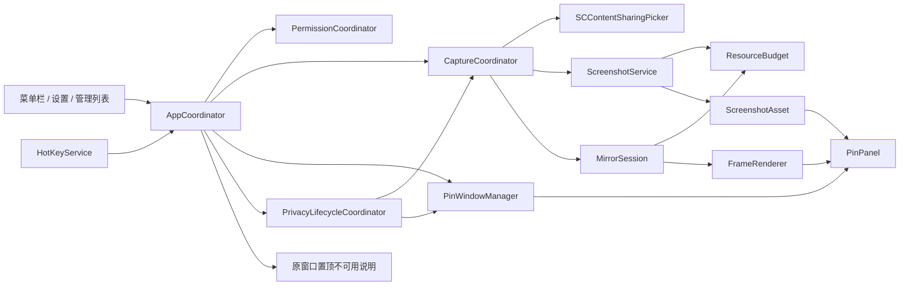
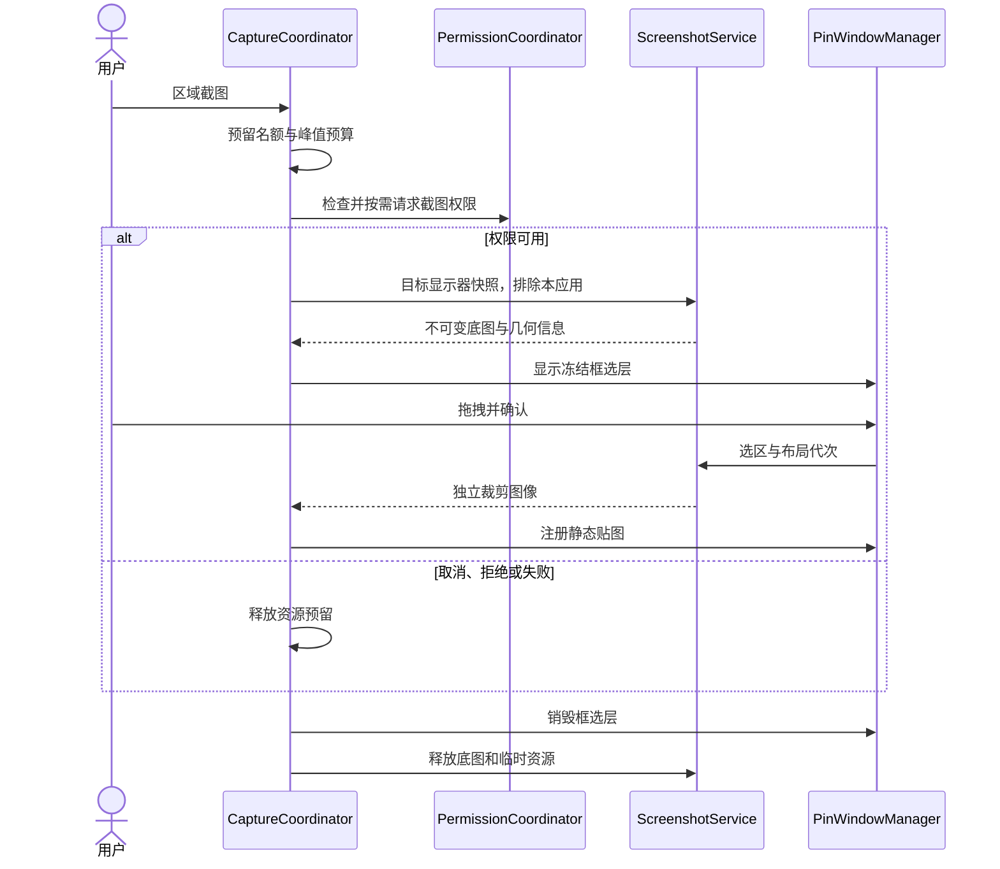
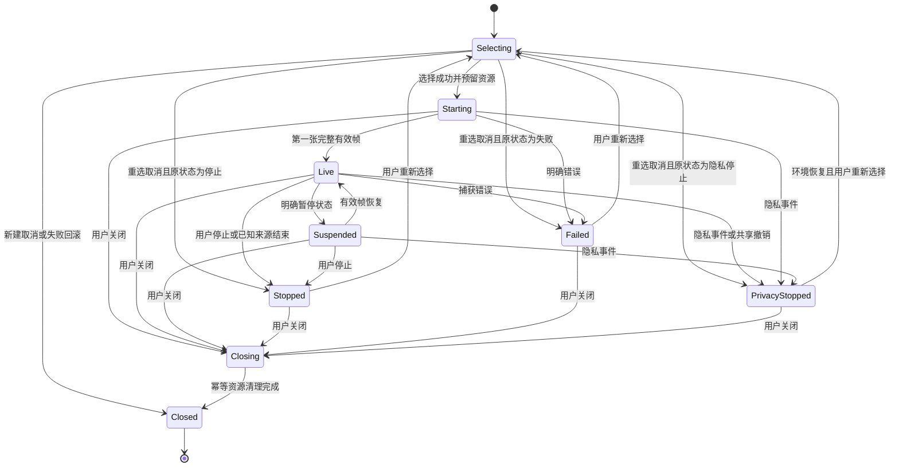

# 「置顶 / Zhiding」技术架构与隐私安全设计

版本：v0.1。状态：工程设计基线，已有 Swift Package 开发原型；实现与设计的差异、已执行检查和待验证门槛见 [当前实现与本机验证](./03-开发路线与验收标准.md#12-当前实现与本机验证)。

导航：[设计总览](./00-设计总览.md) · [产品与交互](./01-产品与交互设计.md) · [开发与验收](./03-开发路线与验收标准.md)

## 1. 架构决策与运行环境

| 方面 | 首版决策 |
| --- | --- |
| 语言与构建 | Swift，使用支持目标系统的稳定版 Xcode；最低部署目标 macOS 14 |
| 芯片 | 规划 `arm64` + `x86_64` Universal，不将 Rosetta 测试替代 Intel 原生测试 |
| 应用入口 | AppKit 生命周期 + `NSStatusItem`；`LSUIElement = true`，无后台辅助进程 |
| 界面 | SwiftUI 承载设置、权限说明和管理列表；AppKit 管理窗口、事件和焦点 |
| 置顶承载 | 自有 `NSPanel` 子类，不修改其他进程窗口 |
| 捕获 | ScreenCaptureKit：系统窗口选择器、单窗口 `SCStream`、`SCScreenshotManager` |
| 图像 | ImageIO 解码/编码，Core Image 转色，Core Image / Metal 渲染 |
| 全局快捷键 | 封装 Carbon `RegisterEventHotKey`，只接收注册的组合，不使用全局事件监听 |
| 存储 | `UserDefaults` 仅存设置；画面和来源信息无持久化 |
| 安全与分发 | App Sandbox + Hardened Runtime，Developer ID 签名公证，DMG |
| 第三方依赖 | 首版无必需的第三方运行时依赖，无服务端和应用内联网功能 |

本文件的接口是职责契约和示意，不是已通过编译的 SDK 调用示例。所有新增 API 必须核对成员级可用性，不能因为框架在 macOS 14 存在就使用其中较新版本成员。

## 2. 模块与依赖



| 模块 | 单一职责 | 线程/隔离边界 |
| --- | --- | --- |
| `AppCoordinator` | 用户命令、菜单状态、设置、批量关闭与退出编排 | `@MainActor` |
| `PermissionCoordinator` | 全局截图权限说明、preflight、请求与重试；不代表系统选择器授权 | UI 主线程；结果异步回传 |
| `CaptureCoordinator` | 串行化选择任务，绑定 picker 回调与会话，预留名额、取消和换源 | `@MainActor`，不处理逐帧像素 |
| `ScreenshotService` | 显示器快照、裁剪、图片校验/导入、显式复制/保存 | 独立有界图像任务队列；同一时间至多一项重型任务 |
| `MirrorSession` | 单路流创建、更新、停止、状态与代次管理 | 每会话串行控制边界 + 捕获回调队列 |
| `FrameRenderer` | 帧元数据校验、转色、GPU 展示、有限缓存 | 每会话串行渲染队列；窗口呈现协调回主线程 |
| `PinWindowManager` | 对象注册表、面板、坐标、显示/穿透/层级、屏幕变更 | `@MainActor` |
| `ResourceBudget` | 数量和内存预留、提交、回滚、压力处理 | 独立 actor，预留操作原子化 |
| `HotKeyService` | 注册、更新与注销四类快捷键 | 主线程安装事件处理；命令转发 `AppCoordinator` |
| `PrivacyLifecycleCoordinator` | 会话离开/休眠/已验证锁屏信号的保护状态 | 主线程协调，优先使会话代次失效 |
| `WindowPinPolicy` / `WindowPinUnavailableView` | 原窗口置顶能力边界与说明；无 AX 枚举、写入或权限请求 | 静态策略 / 主线程 UI |

设计目标按应用、贴图、捕获、服务和模型划分职责。当前开发原型落在 `Sources/Zhiding/`，可独立验证的几何、图像和资源逻辑位于 `Sources/ZhidingCore/`，检查程序位于 `Tests/ZhidingChecks/`；不将目录拆分本身作为验收条件。

### 2.1 模块契约

```text
CaptureCoordinator.beginRegionCapture() -> 创建任务或明确拒绝
CaptureCoordinator.beginMirrorSelection(targetPinID?) -> 单一选择任务
ScreenshotService.importImage(userSelectedURL) -> ScreenshotAsset 或错误
ScreenshotService.freezeFrame(pinID, generation) -> 独立 ScreenshotAsset
PinWindowManager.show(asset/session) -> 唯一 PinID 对应一个面板
MirrorSession.stop(reason) -> 异步结束；重复调用安全
ResourceBudget.reserve(estimate, slots) -> Reservation 或拒绝
Reservation.commit(actualEstimate) / release() -> 恰好提交或回滚一次
AppCoordinator.selectWindowPin() -> 仅显示不可用原因，无权限请求和跨应用副作用
AppCoordinator.prepareForUserAction() -> 忙碌提示 / 原地确认恢复 / 明确取消
```

窗口只由 `PinWindowManager` 创建。帧回调、文件保存回调和权限回调不能直接创建窗口，防止对象已关闭后重新出现。

## 3. 数据模型与身份

| 类型 | 字段或含义 |
| --- | --- |
| `PinID` | 本进程内随机 UUID；对象身份，不是系统窗口 ID |
| `PinItem` | `id`、`kind`、会话内编号、创建时间、窗口 `frameInPoints`、显示器 ID、透明度、`userHidden`、`clickThrough` |
| `ScreenshotAsset` | `assetID`、不可变图像、像素尺寸、sRGB/Alpha 信息、来源种类、原始逻辑尺寸、捕获时间、导出状态、预算引用 |
| `MirrorSession` | `pinID`、`generation`、运行时过滤器、流对象、捕获状态、最后有效帧时间、最近框架状态、资源预留 |
| `FrameEnvelope` | `pinID`、`generation`、样本时间、帧状态、图像缓冲引用、`contentRect/contentScale/scaleFactor` |
| `PickerRequest` | 请求 UUID、目的（新建/换源/重连）、目标 `PinID`、当前代次、保留名额、状态、取消时恢复的原状态 |
| `ScreenshotTask` | 任务 UUID、显示器 ID、屏幕布局代次、取消标志、资源预留 |
| `PrivacyState` | `normal`、`protected`、`awaitingUserResume`；与用户隐藏标记正交 |
| `Settings` | 快捷键组合与启用状态、首次提示标志、外观偏好、设置版本 |
| `notice` / `privacyReason` | 非敏感操作提示与保护原因；仅内存，不包含源窗口标题或画面 |

- 捕获源过滤器由系统传入，在内存中使用，不序列化、不凭窗口标题跨进程重连。
- `CGWindowID`、PID 和显示器 ID 都不是跨启动的永久身份；首版不依赖获得源窗口标题来完成核心功能。
- 静态图从来源复制为本应用独立资产，不依赖源图片文件一直打开。
- PNG 保存成功才将临时截图标为 `exported`；本地导入图标为 `externalCopyExists`；剪贴板复制不改变磁盘导出状态。
- `PinItem` 的位置和透明度只保持当前进程会话；`UserDefaults` 不保存对象数组、标题、捕获过滤器或图像。

## 4. 窗口与焦点管理

### 4.1 自有悬浮窗配置

以下是属性意图，具体初始化由后续技术验证确定：

```text
class: NSPanel 子类
style: borderless + nonactivatingPanel，自定义等比缩放控制
level: floating
isFloatingPanel: true
hidesOnDeactivate: false
becomesKeyOnlyIfNeeded: true
collectionBehavior: canJoinAllSpaces + fullScreenAuxiliary
restorable: false
鼠标穿透: ignoresMouseEvents，默认 false
```

- 创建后使用不要求激活应用的展示方式；普通显示不调用 `makeKeyAndOrderFront` 或周期性 `activate`。
- 展示型面板不作为主窗口；普通图片、状态与工具条不依赖键盘焦点。需要键盘导航/文字输入时打开正常管理窗。
- 显式操作管理窗、保存对话框、权限说明和截图框选允许按系统习惯获取焦点；不能把「非激活」理解为永远不能交互。
- 透明度作用于内容视图/图层，不直接把整窗 `alphaValue` 降到使控件难以辨认。
- 整窗开启穿透后，悬停和点击控件也不可用；解除操作必须独立存在于菜单和管理窗。
- 面板前后顺序只控制本应用同级对象；不使用系统保留高层级，不保证高于其他 App 的浮动面板。

### 4.2 Space、全屏与多显示器

[官方能力] `canJoinAllSpaces` 与 `fullScreenAuxiliary` 提供 Space 行为。它们组合、非激活面板与不同全屏 App 的实际关系是 [待验证]，不能推导出所有全屏环境均支持。

首版默认尝试跨 Space 显示；普通桌面的浮动与不抢焦点属于必测能力。Mission Control 动画、Stage Manager、专用全屏、特殊游戏、系统安全界面分别记录表现。不可用时保留菜单恢复/定位入口，不强制退出其他 App 的全屏。

监听 `NSApplication.didChangeScreenParametersNotification`：

1. 重新枚举 `NSScreen`，用显示器 ID 匹配当前位置。
2. 原屏移除时，将面板移到主显示器；否则约束在其关联屏幕的 `visibleFrame`。
3. 内容保持比例，必要时缩小容器使工具条和关闭入口可达。
4. 正在截图则取消旧任务；镜像展示重新适配目标屏幕，不改捕获源。
5. 更新渲染目标的像素密度，不能把源屏与目标屏的比例混用。

系统镜像显示模式下按活动的屏幕对象去重，不生成重复的框选层；跨屏边缘拖拽后以面板中心所在屏幕更新关联显示器。

## 5. 截图与坐标系统

### 5.1 捕获管线



具体约束：

- 使用 `SCShareableContent` 只服务已授权的区域截图路径，匹配目标显示器及自身应用；不用于镜像的预先全窗口枚举。
- 通过显示器过滤器排除本应用，包括新创建的本应用子窗口；`SCScreenshotManager.captureImage` 配置无鼠标指针、无音频、SDR 输出。
- 不用过时的窗口截图 API 或 shell `screencapture` 绕开这一管线。
- 全屏底图在创建框选层之前取得；框选层不应出现在截图中。
- 底图未成功或几何信息异常不进入框选；布局在底图取得后改变则任务取消。
- 从共享底层缓冲裁剪出的 `CGImage` 可能仍持有整张底图；必须生成选区大小的独立缓冲，再释放全屏底图。
- 小选区不代表捕获时内存很小：先取得完整显示器底图的峰值需纳入预留。

### 5.2 统一坐标契约

不在不同空间之间传递无标签的 `CGRect`。分别封装以下空间：

| 空间 | 定义 |
| --- | --- |
| AppKit 全局空间 | `NSScreen.frame`、面板位置，单位 pt；屏幕位置可能为负数 |
| 框选局部空间 | 当前显示器视图左上角为原点，x 向右、y 向下，单位 pt |
| 底图像素空间 | 规范化为左上角原点，使用实际返回图像的 `width/height`，单位 px |
| 镜像帧空间 | 框架输出缓冲及其有效内容元数据，经独立适配器转换 |

区域截图先通过 AppKit 视图坐标转换取得局部点，再按以下约定转换，避免使用主显示器高度翻转所有屏幕：

```text
显示器尺寸：Wpt × Hpt；规范化底图尺寸：Wpx × Hpx
局部选区：[x0, y0, x1, y1]，左上原点，已排序并裁剪到显示器范围
sx = Wpx / Wpt；sy = Hpx / Hpt
像素左上 = (floor(x0 * sx), floor(y0 * sy))
像素右下 = (ceil(x1 * sx), ceil(y1 * sy))
结果再次裁剪到 [0, Wpx] × [0, Hpx]，拒绝空区域或非有限值
```

如果获取的是 AppKit 底部原点局部矩形，先转换 `topY = Hpt - (bottomY + height)`，只转换一次。Core Graphics/Metal 的图像方向差异统一收敛在图像适配层，不在多个模块各翻转一次。

测试样本：显示器全局原点 `(-1280, 200)`、逻辑尺寸 `1280×720 pt`、底图 `2560×1440 px`；全局底部原点选区 `(-1180, 720, 300, 100)` 转为局部顶部原点 `(100, 100, 300, 100)`，像素选区应为 `(200, 200, 600, 200)`。再用 1×、不同 x/y 比例及分数边界测试相同转换。

### 5.3 图像方向与颜色

- 本地 JPEG 等根据方向元数据规范化像素方向，防止显示与导出旋转不一致。
- ImageIO 读取实际类型与尺寸，允许颜色配置，但导出统一转为 SDR/sRGB PNG，清除来源 EXIF、GPS、备注等不必要元数据。
- 截图与复制只包含图像内容；窗口透明度、缩放、边框、圆角和工具条不烘焙进原图。
- 受保护内容产生黑色或空白不做像素猜测后强行绕过；仅根据框架错误/状态和用户报告提示。

## 6. 系统选择器与并发关联

### 6.1 选择器配置

使用共享 `SCContentSharingPicker` 并注册唯一观察者。在用户发起选择前将 `isActive` 设为 true；有活跃会话或未终结选择请求时保持激活，二者都不存在时关闭 picker 激活状态，退出时移除观察者。激活 picker 不等于已经开始捕获。

配置如下：

- `allowedPickerModes` 限定 `.singleWindow`，排除应用/显示器/多窗口选择模式。
- `excludedBundleIDs` 包含本应用 Bundle ID；按需补充自有窗口 ID，防止镜像自身形成递归。
- `maximumStreamCount` 设为 3；应用自己的镜像对象数量限制另外执行，因为已停止对象也占名额。
- 为活跃流保留系统显式换源能力，设置 `allowsChangingSelectedContent`；按系统传来的已关联流回调更新，不自行扩大内容范围。
- 只调用 macOS 14 可用的配置项；WWDC 演示中的旧签名不能未经核对直接作为实现。

### 6.2 回调路由与取消

系统回调有时包含 `SCStream`，有时为 `nil`，并不回传本应用的请求 UUID。必须同时采用以下约束：

1. 本应用发起的新建/重连选择只有一个 `pendingRequest`；框选期间也不允许开启新选择器。
2. `stream != nil`：通过流对象身份查找 `pinID + generation`。已停止、已释放或代次不匹配的回调直接忽略。
3. `stream == nil`：仅允许匹配当前仍有效的单一新建/重连请求；没有请求时忽略，不凭系统回调自动新建镜像。
4. 取消、失败、成功都是终结事件，恰好一次释放或提交名额。上一请求的系统选择 UI 尚未结束时，不发起新的呈现。
5. 用户在系统共享界面更改一个已知活跃流时，可接受关联过滤器作为明确选源；立即阻止旧帧展示，再检查模式和预算、串行更新配置与过滤器。校验失败则停止该流并保留错误占位。
6. 系统全局「启动失败」回调没有流标识时只结束当前呈现请求，不能关闭其他正在捕获的会话。
7. 新建对象先保留名额，取得过滤器后再按输出尺寸预留帧内存；任一步失败都回滚，不占用幽灵名额。

内部 UUID 不能神奇地给 `nil` 系统回调补充身份。取消后立刻重开、系统菜单触发和多个会话换源的回调顺序属于 G01 必测门槛；若无法消除歧义，保持当前流程不可重入并报告错误，不猜测归属，也不靠固定延时碰运气。

### 6.3 换源事务

- 用户打开已有镜像的选择器，取消时保留旧流、旧帧和原状态。
- 收到用户确认的新过滤器时先禁止旧帧提交、增加 `generation` 并清除展示缓存，再检查新来源预算；预算不足则停止该流、保留错误占位，不继续捕获可能已不再授权的旧源。
- 在同一个流上串行调用过滤器/配置更新；新代次的首帧到达后才标记「实时」。
- 更新期间可能有旧缓冲在途。以 SDK 的完成边界、时间戳和串行队列验证新旧帧隔离，不认为修改一个整数就能辨认所有底层帧。
- 无法证明切换边界可靠时，结束旧流并要求重新通过系统选择器开始新会话；允许保留管理对象但不展示可能混源的帧。
- 更新失败时结束当前流、清帧并进入失败状态，不自动回退捕获旧来源。

## 7. 镜像状态与帧渲染

### 7.1 生命周期状态机



以上为主路径，任何非终态都必须接受关闭/退出命令。已有对象重选取消/选择器失败时恢复请求中保存的原状态，不删除占位对象；活跃流的换源选择属于独立 UI 子流程，确认前仍保持原捕获状态。`userHidden` 和全局隐私遮罩不是捕获状态，不能用单个 `isPaused` 混合表示隐藏、最小化、授权结束和错误。

### 7.2 帧状态处理

| 框架/输入情况 | 处理 |
| --- | --- |
| 有效 `CMSampleBuffer` + `complete` + 可用像素缓冲 | 校验会话代次和几何信息，提交最新帧 |
| `started` | 等待完整有效画面，不把无效起始缓冲当成图片 |
| `idle` | 内容未变化，保持最后帧；不误报断流 |
| `suspended` | 显示暂停状态，等待有效帧或终结事件；不推断必然是最小化 |
| `blank` | 保守进入隐私停止并清帧；这是停止策略，不声称已证明锁屏 |
| `stopped` 或系统共享终止 | 结束流，原因不明时按隐私停止清帧处理 |
| 无效缓冲/越界元数据 | 丢弃并记录脱敏错误码；连续 5 张应可处理但无效的帧后进入失败，完整有效帧将计数清零；`idle` 等无图像状态不计为无效帧 |
| 长时间无新帧 | 显示最后有效帧时间，不仅凭超时判错或擅自重启 |

只有明确的用户停止或可确认的来源结束可以保留带「已停止」标记的最后帧；授权撤销、系统停止共享、隐私事件及不明错误默认清除。画面已清除后「转贴图」不可用。

### 7.3 输出配置

- 视频 `.screen` 输出，`capturesAudio = false`、`showsCursor = false`；不添加音频或麦克风输出。
- BGRA SDR/sRGB 路径，`queueDepth = 3`。
- 可见镜像最小帧间隔 `1/30 s`；用户隐藏时改为 `1 s`，菜单仍标记会话活跃。更新失败不能悄悄持续高帧率：停止该流并显示错误。
- 读取过滤器逻辑尺寸和 `pointPixelScale` 估计原始像素尺寸；等比缩小到不超过 2,073,600 px，并限制单边不超过 4096 px，避免极端长宽比导致纹理问题。
- 缩放系数取 `min(1, sqrt(2073600 / (w*h)), 4096/w, 4096/h)`，输出维度向下取整并检查大于零；使用检查溢出的乘法。
- 用户缩放镜像窗只改变显示比例，不在拖拽每一帧重建捕获输出。源尺寸稳定变化后最多每 500 ms 合并一次配置更新，旧/新缓冲重叠纳入预算。
- 不使用 `sourceRect` 对单窗口流做局部捕获：官方文档说明其对单窗口捕获不生效。展示有效内容区域使用帧元数据，不伪装为该属性已裁剪来源。

### 7.4 几何与 GPU 管线

1. 从样本附件读取 `contentRect`、`contentScale`、`scaleFactor`，同时读取实际像素缓冲宽高。
2. `FrameGeometryAdapter` 将 SDK 元数据规范化为「输出缓冲内有效像素矩形 + 源逻辑尺寸 + 目标展示矩形」；拒绝非有限、负数、空或越界范围。
3. 适配器按所用 SDK 的元数据单位处理，不把过滤器 `contentRect` 的 pt、帧内容矩形和视图 pt 直接混算；用 1×/2×、缩小源窗、跨屏样本核对输出，见 G04。
4. 以 Core Image 读取像素缓冲，并渲染到 Metal 内容视图；保持比例，使用 sRGB 输出。必要时裁剪缓冲的填充区，不拉伸内容。
5. 保留独立的最后展示纹理，GPU 使用完成后释放对捕获缓冲的引用，不永久占用框架表面池来保存「最后一帧」。
6. 只在到达有效新帧、窗口尺寸改变或 UI 明确需要刷新时绘制；静态贴图和 `idle` 不运行无意义的 30 fps 渲染循环。

每会话最多保留一个正在渲染的捕获缓冲及一个「最新待处理」缓冲；新帧替换尚未处理的旧帧，绝不建立无界任务队列。GPU 使用中的资源必须等完成通知后释放，不能为追求丢帧提前释放正在使用的内存。

逐帧像素数据不进入 SwiftUI `@Published`/主线程数组。主线程只接收低频状态和布局通知；转贴图是用户触发的一次性 GPU/CPU 复制，不是每帧转换成 PNG 或 `NSImage`。

## 8. 资源预算与清理

### 8.1 数量与内存的双重上限

- 静态贴图 20 张、镜像对象 3 个；隐藏和已停止对象仍占名额，创建中预留也占名额。
- 所有静态图像最多 32 MP；编码输入最多 50 MiB。屏幕底图不是最终贴图，但同样受工作内存预算约束。
- 应用级图像/帧/临时资源估算预算 512 MiB；不把它当作进程 RSS、GPU 总内存或 WindowServer 内存的硬上限。
- 分配前预留，结果产生后按实际尺寸核账；失败、取消、关闭时回滚。到上限拒绝新对象，不自动关闭已有内容。

估算模型：`S = 对齐后的 bytesPerRow × height`，以下倍数是保守起点，验证后只能经记录调整：

| 资源 | 预算项 |
| --- | --- |
| 静态贴图 | 至少 `2S`（解码图 + 展示纹理），另计缩略图和编码数据 |
| 镜像 | 至少 `3S_capture + 2S_present + 3S_drawable`，分别覆盖帧池、独立展示纹理和呈现缓冲 |
| 全屏底图 | 至少 `3S_display`，覆盖捕获结果、框选纹理与临时转色；另预留最终裁剪图 |
| 解码/导出 | 编码输入、独立解码/转色目标和编码输出分别计入峰值，不复用同一额度假装无复制 |
| 换源/改分辨率 | 新旧缓冲同时存在期间都计入；不足时不增加分辨率或拒绝换源 |

`S_present` 和 `S_drawable` 取实际渲染目标的像素尺寸，不能只用较小的捕获尺寸估算放大后的窗口；渲染目标仍限制为该镜像像素预算，由显示合成器适配更大的逻辑窗口。

同一资产被多个引用共享时只记一份实际缓冲，但镜像转贴图生成的独立缓冲必须新增预算。框选底图裁剪的共享引用也不能假装已经释放全图。

系统内存压力警告时先清除可再生缩略图、停止接受重型新任务并降低活跃镜像输出；严重压力下停止镜像并释放帧，保留占位对象和静态贴图，向用户说明。不得把敏感图像写临时文件来规避预算，也不承诺系统极端内存压力下绝不会终止应用。

### 8.2 幂等关闭顺序

1. 标记 `closing`，增加代次，禁止新的帧、状态和窗口提交。
2. 取消关联 picker/截图请求与未开始的图像任务；使迟到结果失效。
3. 从显示层移除画面和鼠标交互，不等待停止 API 完成才遮住敏感内容。
4. 对活跃流发起 `stopCapture`；已停止或从未启动的流也通过同一清理出口处理。
5. 移除流输出/观察关系，清空待处理缓冲，等待已提交 GPU 工作完成后释放其资源。
6. 释放过滤器、最后帧、临时图和面板引用，再由注册表移除对象；预算随实际引用释放归还。
7. 重复停止/关闭不重复归还预算；失败或迟到回调不能再次创建对象。

停止 API 超时视为异常：保持画面已隐藏与会话不可提交，记录错误，不声称「资源已释放」。退出时允许进程最终结束并由系统回收；清理完成前不能把尚未回收的名额作为新捕获容量重复使用。

### 8.3 图像任务与退出

保存只由用户发起。开始编码前持有资产的有界引用，面板关闭不导致悬空内存；保存回调只更新仍存在且匹配的对象，不重新创建贴图。

退出流程先询问未导出静态图，再停止新任务、结束流、等待已获用户授权的保存任务完成或返回失败，最后注销快捷键和状态项。强制退出不提供数据恢复承诺。

## 9. 权限模型

### 9.1 区域截图权限

使用公开的 `CGPreflightScreenCaptureAccess` 检查、用户确认后用 `CGRequestScreenCaptureAccess` 请求。preflight 返回 false 只证明当前未获准，不能单凭它区分「未决定」「曾拒绝」「已撤销」。

授权后重新检查并由实际截图结果确认；系统要求重启时显示手动重启提示，保护尚未导出的内容。应用返回前台或用户重试时刷新状态，不循环弹系统对话框。

权限面板跳转属于便利功能，不依赖未公开的系统设置深链：可以尝试系统设置导航，失败则提供手动路径。不可设置一个固定旧版本菜单名当作所有系统的真实文案。

### 9.2 镜像会话授权

[官方能力] 系统选择器给予用户选择内容的会话访问权，不要求应用先拥有完整屏幕录制授权。因此：

- 镜像按钮不能被全局 preflight=false 禁用。
- 不在镜像流程前调用可能需要全局权限的 `SCShareableContent` 来构造自己的缩略图列表。
- 系统过滤器是本会话授权边界，不擅自换成整屏、同 App 全窗口或其他未选内容。
- 系统停止/撤销必须结束对应流，不通过旧过滤器重新创建流绕过；重新开始由用户显式选择。
- 普通设置持久化不包含过滤器、授权令牌或可恢复源标识。

### 9.3 不请求的权限

核心功能不请求辅助功能、输入监控、自动化 Apple Events、完全磁盘访问、摄像头或麦克风。全局快捷键用登记组合的 API，不使用 `CGEventTap`/全局键盘监听作为默认兜底。

只读镜像没有理由以「可点击原窗口」为由扩大权限。未来新增功能若需要权限扩展，必须重新设计，不沿用首版说明蒙混启用。

### 9.4 原窗口置顶路线更正（不可用）

SDK `AXAttributeConstants.h` 的 `kAXSubroleAttribute` 明确为只读类型信息（`Writable: No`）。`AXFloatingWindow` 描述已有浮动窗口，不是改变另一个应用窗口层级的开关；写入/读回不能作为置顶成功证据。旧 `WindowPinService`、AX 后端和合成成功测试已移除。

[Apple App Sandbox 文档](https://developer.apple.com/documentation/security/protecting-user-data-with-app-sandbox) 将辅助应用使用 Accessibility API 列为不兼容功能。当前包实际启用了 `com.apple.security.app-sandbox`；TCC 授权与沙盒能力是独立条件，不能把全部失败认定为授权缓存或签名问题。

- Debug/Release 均不再枚举或尝试写入原窗口，也不再请求辅助功能授权。
- 保留能力说明入口，旧实验开关不再参与运行；不将任意模拟后端的成功判定为平台可行性。
- 原窗口可操作置顶需求仍未实现。镜像只能查看，不作为等价替代；当前范围不改沙盒，不引入注入、私有 API 或循环重提。
- 屏幕录制权限直达面板保留；辅助功能深链仅用于用户查看/自行撤销旧授权。跳转返回 true 只表示系统接收 URL，不表示已定位或授权成功。

## 10. 隐私生命周期与锁屏风险

### 10.1 可用公开信号与边界

通过 `NSWorkspace.shared.notificationCenter` 观察：

- `willSleepNotification`：系统即将睡眠。
- `screensDidSleepNotification`：屏幕进入休眠。
- `sessionDidResignActiveNotification`：用户会话切换离开。
- 对应的唤醒/会话恢复通知只用于显示「等待用户恢复」，不自动开始捕获。

同时处理 ScreenCaptureKit 的 `blank`、停止和错误信号。[官方能力] 这些信号分别表示各自的事件；**它们不是官方承诺的、覆盖所有锁屏动作的统一检测 API**。仅锁屏但屏幕仍亮、合盖、快速用户切换等需要分别实测。

首版不引入未公开锁屏通知名称、未公开会话字典字段或额外系统权限来伪装确定性。G03 验证必须确认支持平台上的保护信号与捕获终止时机；若任何锁屏路径继续捕获或解锁自动泄露画面，阻断镜像功能对外发布并回到设计评审，不能只在说明中淡化这一缺口。

### 10.2 保护事务

1. 全局状态切到 `protected`；立即增加所有捕获和截图任务的代次，拒绝新输入任务。
2. 主线程隐藏面板及管理缩略图；渲染队列停止接受新画面，清除最后镜像帧。
3. 停止所有流、关闭框选 UI、释放在途底图；不写入临时磁盘。
4. 静态贴图内容保留在内存，但受全局隐私遮罩保护；`userHidden` 的原值不被覆盖。
5. 系统返回交互会话后进入 `awaitingUserResume`，不展示敏感图像。
6. 用户「恢复显示」后解除遮罩，恢复静态图和镜像占位；镜像逐个重新选择才开始捕获。

任何不能确认已处于可交互会话的状态都不恢复画面。数据能被操作系统捕获到与应用实际消费帧之间存在异步边界，因此验收不仅看窗体隐藏，还必须检查流回调、独立测试源计数和系统共享状态。

### 10.3 受保护状态的用户操作

- 系统恢复通知不自动显示内容。用户主动点截图/镜像/粘贴/导入时，通过统一 `prepareForUserAction()` 就地确认「恢复显示并继续」。
- 默认取消；未确认时不读取屏幕/剪贴板或启动任务。恢复只显示原先可见的面板，不改变手动隐藏标记，不自动重启镜像。
- 确认前记录操作代次；确认期间若发生新的保护事件，拒绝旧确认，继续保持保护。防止嵌套恢复弹窗。
- `notice` 与 `privacyReason` 提供非敏感提示，不经被隐私状态抑制的普通 `message()` 路径。忙碌、等待系统选择器等状态明确反馈，不因静默返回让用户以为必须关闭全部。
- 停止任务捕获触发保护时的旧会话身份；迟到回调不能停止后续重选的新会话。
- 设置、权限跳转、能力说明与清理动作不要求恢复显示。

## 11. 文件、剪贴板与数据安全

- 应用不建立历史库、磁盘缩略图、自动恢复文件或包含画面的日志；禁用面板状态恢复，不把图像加入 `UserDefaults`。
- 使用 `NSOpenPanel`/`NSSavePanel` 的用户选择授权；需要时在任务作用域内平衡 security-scoped URL 的访问，不持久化长期书签。
- 扩展名仅用于界面筛选；ImageIO 校验实际 PNG/JPEG 类型、尺寸、方向和帧数，拒绝损坏文件、异常尺寸、整数溢出和超限资源。
- 剪贴板只读明确支持的图片表示，PNG 优先、TIFF 次之；首帧之外不创建额外对象，编码数据同样执行 50 MiB 和 32 MP 校验。
- 剪贴板服务可能在读取表示时就分配数据，应用不宣称能在取回数据前保证零内存增长；读取后立即限长，解码前再次检查元数据和预算。
- 只导出静态 PNG，最小必要颜色信息；不传播原文件 GPS、评论或来源 App 标题。不使用用户元数据拼接任意路径。
- 在用户选定目标的授权范围内安全写入；写失败保留当前贴图和目标原文件，不能以写失败为由删除用户已有文件。
- 不加载 HTML/SVG、远程图片、不按剪贴板 URL 请求网络、不调用 shell 处理图片。
- 用户主动复制/导出是应用内存边界之外的分享动作；不承诺删除外部副本、剪贴板同步记录或系统换页数据。

### 11.1 日志

使用 `Logger` 记录会话阶段、匿名运行时编号、错误域/码、耗时、帧计数和资源估算。禁止记录像素、剪贴板正文、窗口标题、完整文件路径及过滤器完整描述。

第三方框架/系统错误的 `localizedDescription` 可能包含路径或标题，不直接写入日志；先映射到应用错误枚举。用户可见的失败提示也不需要暴露敏感来源信息。首版无自动诊断上传，性能测试使用合成数据。

## 12. 设置与全局快捷键

`HotKeyService` 统一封装 Carbon 注册和事件生命周期。按命令 ID 映射四个功能，只处理已登记组合；不抓取普通按键或输入内容。

修改流程：校验格式与系统保留组合 → 尝试注册新组合 → 成功后更新设置并注销旧组合；失败保持旧组合。注册相同组合当作无变化，避免自己与自己冲突。禁用时立即注销，退出时释放所有注册和处理器。

同一应用内重复组合直接拒绝；外部冲突以 API 返回的可识别信息提示，不声称检测到任意 App 的内部菜单快捷键。现代系统对部分修饰键组合有限制，默认选择 `Option + Command + 数字`，但仍在签名沙盒包上验证；失败时菜单功能保持可用，不改用监听权限兜底。

设置版本化但不采用数据库；未来迁移只涉及非敏感设置，损坏时恢复默认并提示，不凭损坏值启动捕获。

## 13. 发行与签名安全

### 13.1 权限配置基线

首版发行所需配置是设计基线，不是本次生成的 entitlement 文件：

| 配置 | 决策 |
| --- | --- |
| App Sandbox | 启用 `com.apple.security.app-sandbox` |
| 用户选择文件 | 启用 `com.apple.security.files.user-selected.read-write` |
| Hardened Runtime | 启用并保留默认安全保护 |
| 网络客户端/服务端 | 不启用，首版无应用内网络需求 |
| 音频输入、摄像头、Apple Events | 不启用 |
| JIT、可执行内存、关闭库校验 | 不启用 |
| `get-task-allow` | 发行构建不得为 true |

屏幕录制的 TCC 授权不是靠添加一个自造的 entitlement 或用途字符串获得的。以构建 SDK 的官方要求核对配置；系统 UI 的共享指示和权限提示不可被应用隐藏。

辅助功能授权不是自造 entitlement 能获得的，也不能解除 App Sandbox 的跨应用控制限制。原窗口置顶错误路线已撤下，所有构建均不再请求该权限，见 9.4。

### 13.2 发布流水线设计

1. 固定真实的发布者、Bundle ID、显示名称及 Team ID；凭证放钥匙串/CI 机密管理，不写入仓库、文档或日志。
2. 以 Release 配置归档 Universal 应用，确认最低系统版本、两种架构及不含调试权限。
3. 使用 Developer ID Application 证书、Hardened Runtime 和安全时间戳签名应用；所有嵌套可执行体逐一有效签名。
4. 提交应用公证并检查通过状态和日志；公证不是 Mac App Store 审核，不等同于隐私/功能测试。
5. 为应用装订可离线验证的票据，再制作并签名 DMG；对最终 DMG 公证、装订票据和验证。后续若采用不同打包顺序，需要重新证明内部应用和最终容器的离线首次运行有效性。
6. 检查签名、Gatekeeper、公证票据，在从浏览器下载的隔离属性环境下测试，不把手动去除隔离属性当作安装步骤。
7. 使用真实全新用户环境测试首次启动、权限路径、离线首次运行和升级覆盖。

首版通过官网下载/用户分发 DMG 手动安装与更新，不接入自动更新服务。Apple Developer 账号、Developer ID 证书、发布渠道和测试设备是后续前置条件，本次不申请、不上传、不执行发布命令。

### 13.3 安装、升级与卸载边界

用户将应用拖入 Applications 后运行，首次只有说明界面，使用捕获时才授权。升级覆盖前提醒退出，未保存贴图走既定确认流程；新版本不自动恢复旧捕获会话。

没有后台服务、内核扩展、特权 helper 或自启任务。卸载应用不会删除用户主动导出的 PNG，也不会撤销已复制到其他软件的内容。设置残留仅含非敏感偏好，可通过后续明确的用户操作清除；安装/卸载不要求关闭系统安全保护。

## 14. 技术风险、门槛与资料

| 风险 | 验证编号 | 失败处理 |
| --- | --- | --- |
| 系统 picker 的取消、换源、`nil` 回调归属 | G01 | 不猜归属，阻断相关捕获流程，修正后才进入产品化 |
| 非激活浮动面板与全屏/Space 组合 | G02 | 普通桌面不通过则阻断；非核心全屏组合登记不支持 |
| 锁屏与恢复隐私保护的公开信号不完整 | G03 | 阻断镜像对外发布，重新评审；不增加私有 API |
| 帧元数据、旋转、屏幕比例解释错误 | G04 | 阻断对应捕获/布局，不以固定倍数凑结果 |
| 沙盒发行包权限、快捷键、公证行为 | G05 | 修正支持的配置或回到评审，不申请无关权限 |
| 大图、换源、关闭和 GPU 资源泄漏 | G06 | 收紧资源实现并复测，不用磁盘缓存掩盖 |

详见 [开发路线与验收标准](./03-开发路线与验收标准.md)。当前这些门槛均未完成实机验证。

官方依据：

- [系统选择器、截图 API，WWDC23](https://developer.apple.com/videos/play/wwdc2023/10136/)
- [单窗口行为、元数据与缓冲，WWDC22](https://developer.apple.com/videos/play/wwdc2022/10155/)
- [会话授权与隐私，WWDC23](https://developer.apple.com/videos/play/wwdc2023/10053/)
- [SCContentSharingPicker](https://developer.apple.com/documentation/screencapturekit/sccontentsharingpicker)、[Picker 配置](https://developer.apple.com/documentation/screencapturekit/sccontentsharingpickerconfiguration-swift.struct)、[Picker 观察者](https://developer.apple.com/documentation/screencapturekit/sccontentsharingpickerobserver)
- [SCContentFilter](https://developer.apple.com/documentation/screencapturekit/sccontentfilter)、[pointPixelScale](https://developer.apple.com/documentation/screencapturekit/sccontentfilter/pointpixelscale)、[sourceRect 的单窗口限制](https://developer.apple.com/documentation/screencapturekit/scstreamconfiguration/sourcerect)
- [SCFrameStatus](https://developer.apple.com/documentation/screencapturekit/scframestatus)、[帧内容矩形](https://developer.apple.com/documentation/screencapturekit/scstreamframeinfo/contentrect)
- [NSPanel](https://developer.apple.com/documentation/appkit/nspanel)、[非激活面板](https://developer.apple.com/documentation/appkit/nswindow/stylemask-swift.struct/nonactivatingpanel)、[浮动层级](https://developer.apple.com/documentation/appkit/nswindow/level-swift.struct/floating)
- [会话切换通知](https://developer.apple.com/documentation/appkit/nsworkspace/sessiondidresignactivenotification)、[屏幕休眠通知](https://developer.apple.com/documentation/appkit/nsworkspace/screensdidsleepnotification)
- [macOS 公证要求](https://developer.apple.com/documentation/security/notarizing-macos-software-before-distribution)

官方页面对成员单位或平台组合说明不足的地方保留为有明确用例的验证项，不以论坛经验代替系统保证。
